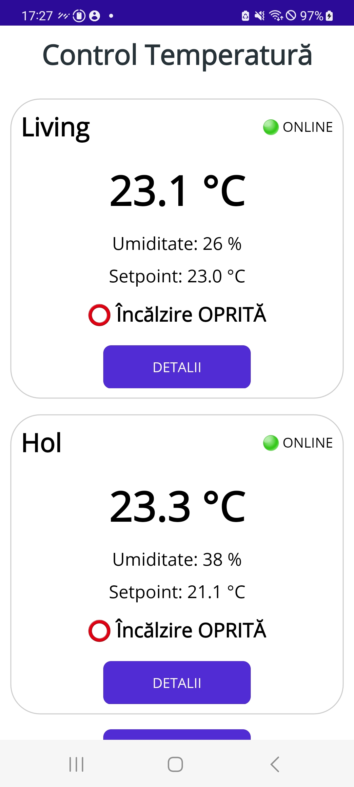

# Thermostat Control App

An Android application built with C# and .NET MAUI to monitor and control ESP-based thermostats through a Node.js backend running on Linux.

## Screenshots

### Room Overview
Displays connected rooms, current temperature, humidity, target temperature, heating status, and device connectivity.

### Room Details
Provides controls for the target temperature and sensor calibration, along with the current device status.

## Features

- Monitor temperature and humidity for multiple rooms
- Display device connectivity and heating status
- Adjust the target temperature
- Calibrate temperature sensor readings
- Communicate with a Node.js backend through HTTP/REST
- Manage ESP-based thermostat devices

## Architecture

- **Mobile application:** C#, .NET MAUI, XAML, MVVM
- **Backend:** Node.js and Express
- **Communication:** REST API and JSON
- **Hardware:** ESP-based devices
- **Server environment:** Linux

The mobile application retrieves device data from the backend and sends control settings through the API. The backend exchanges data with the ESP devices.

## Project Goals

This personal project combines mobile application development, backend integration, and embedded systems in a practical IoT solution.

## Technologies

`C#` ` .NET MAUI` `XAML` `MVVM` `Node.js` `Express.js` `REST API` `JSON` `Linux` `ESP32/ESP8266`

## Repositories

- Mobile application: https://github.com/ClaudiuG18/TermostatDotnetMaui
- Backend server: https://github.com/ClaudiuG18/LocalServer/tree/DotnetMAUI

